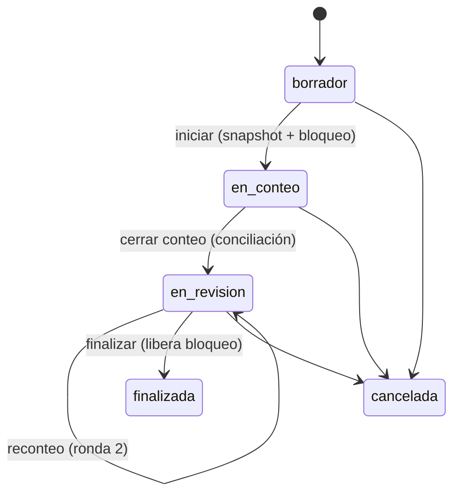

# Diseño técnico

## Decisiones de arquitectura

- El stock vigente es `cantidad_nueva` del renglón con mayor `id` de
  `alta_inventarios` por producto+sucursal. El `id` es monotónico, por eso el
  "corte" de una auditoría y de cada captura es `MAX(alta_inventarios.id)`.
- Bodega = sucursal con `es_bodega`; mismo ledger, mismo flujo.
- No existe columna SKU: el reporte usa `barcode` o, si está vacío, el `id`.
- Rol único `auditor`. Sin `id_empresa`/`id_sucursal`; su alcance vive en
  `auditor_alcances` (`id_sucursal` null = todas las sucursales de la empresa).
- El auditor abre la auditoría. superAdmin puede hacerlo como soporte.
  adminEmpresa sólo consulta y cancela.
- Máximo una auditoría activa (`borrador|en_conteo|en_revision`) por sucursal.
- Bloqueo en capa de servicio (cubre web y POS) + observer `creating` en
  `AltaInventario` como respaldo. Las ventas nunca se bloquean.
- Conteo ciego: ningún endpoint de captura devuelve existencias del sistema
  antes de `en_revision`.
- El módulo nunca crea renglones en `alta_inventarios`.

## Estados

## Conciliación por renglón

| Campo | Cálculo |
|---|---|
| `cantidad_sistema_inicio` | último renglón del ledger con `id ≤ corte_inicio_id` |
| `esperado_al_conteo` | último renglón con `id ≤ corte_conteo_id` (corte de la última captura vigente) |
| `movimientos_durante` | `esperado_al_conteo − cantidad_sistema_inicio` |
| `ventas_offline_tardias` | Σ `producto_ventas.cantidad` de ventas de la sucursal con `occurred_at ≤ contado_at` y `created_at > contado_at` |
| `esperado` | `esperado_al_conteo − ventas_offline_tardias` |
| `diferencia` | `cantidad_contada − esperado` |
| `transito_salida/entrada` | transferencias `pendiente` desde/hacia la sucursal (informativo) |

Renglones sin captura al cerrar: contado = 0 (con confirmación explícita).
Aritmética con `App\Services\Pos\Decimal` (enteros ×100).

## Fases

| Fase | Contenido |
|---|---|
| 1 | Migraciones, modelos, rol auditor (alta, login, menú, alcance) |
| 2 | Flujo: crear, iniciar, captura ciega, cerrar, reconteo, finalizar, cancelar |
| 3 | Bloqueo híbrido (servicios, observer, POS, banners) |
| 4 | Conciliación y reporte por auditoría (pantalla, XLSX) |
| 5 | Reporte histórico/consolidado |
